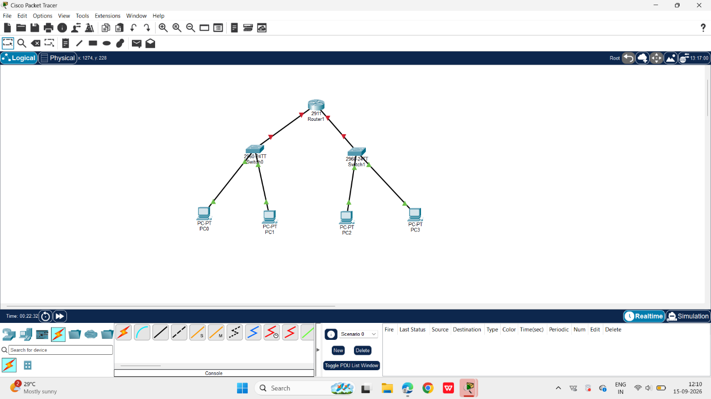
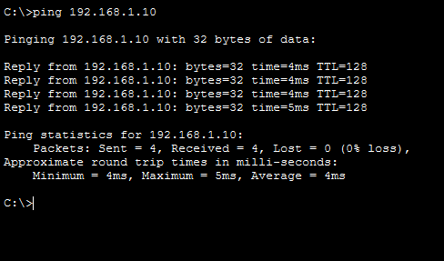
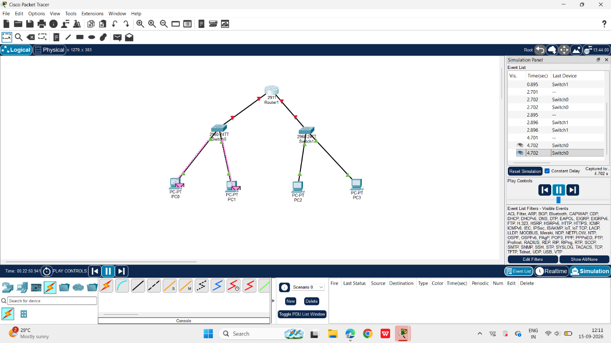

# Network Models and Protocols (NPC)

[](https://github.com/kawdeyash/Network-Models-and-Protocols)
[]()
[]()
[]()

Comprehensive practical laboratory assignments, simulation files, packet captures, and technical reports for the **Network Models and Protocols / Networking Protocols and Communication (NPC)** curriculum.

---

## Student & Course Details

| Field | Details |
|---|---|
| **Author / Student Name** | Yash Kawade |
| **PRN** | `2125UCSM1118` |
| **Department** | Cyber Security |
| **Course / Subject** | Network Models and Protocols (NPC) |
| **Institution** | Sanjivani University, Kopargaon |
| **Repository** | [kawdeyash/Network-Models-and-Protocols](https://github.com/kawdeyash/Network-Models-and-Protocols) |

---

## Course Curriculum & Practical Units

| Unit | Title | Key Tools & Protocols | Status | Link |
|---|---|---|:---:|:---:|
| **Unit 1** | **Building a LAN in Cisco Packet Tracer** | Cisco Packet Tracer, IPv4, ICMP Ping, Switching & Routing | Completed | [Unit 1 Docs](./Unit-1-Building-a-LAN/) |
| **Unit 2** | **Protocol Analysis with Wireshark** | Wireshark, Kali Linux, TCP 3-Way Handshake, HTTP GET | Completed | [Unit 2 Docs](./Unit-2-Wireshark-Protocol-Analysis/) |
| **Unit 3** | **DNS & Web Server Configuration** | Cisco Packet Tracer, DNS A-Record, HTTP Server | Completed | [Unit 3 Docs](./Unit-3-DNS-and-Web-Server/) |
| **Unit 4** | **DHCP Server & Network Setup** | Cisco Packet Tracer, DHCP Pool, Dynamic IP Allocation | Completed | [Unit 4 Docs](./Unit-4-DHCP-Configuration/) |
| **Tool** | **Python Network Scanner** | Python 3, Win32 SendARP, Multi-threaded Host/MAC Discovery, Reporting | Active | [Scanner Docs](./Python-Network-Scanner/) |

---

## Unit 1 Spotlight: Building a Local Area Network (LAN)

### Task Outline
- **Objective:** Design and simulate a Local Area Network (LAN) in Cisco Packet Tracer consisting of **1 Router**, **2 Switches**, and **4 PCs**.
- **Addressing:** Assign static IPv4 addresses and subnet masks across all endpoints.
- **Verification:** Demonstrate communication across switches using ICMP `ping` and Packet Tracer simulation analysis.

### Network Architecture
- **Router:** 1 × Cisco 2911 Router (`Router1`)
- **Switches:** 2 × Cisco Catalyst 2960-24TT Switches (`Switch0`, `Switch1`)
- **End Devices:** 4 × PC-PT workstations (`PC0`, `PC1`, `PC2`, `PC3`)
- **Topology:**
  - `PC0` and `PC1` connect to `Switch0`
  - `PC2` and `PC3` connect to `Switch1`
  - `Switch0` and `Switch1` connect to `Router1`

```
                  +-------------------+
                  |  Router1 (2911)   |
                  +---------+---------+
                            |
             +--------------+--------------+
             |                             |
      +------+------+               +------+------+
      | Switch0     |               | Switch1     |
      | (2960-24TT) |               | (2960-24TT) |
      +---+-----+---+               +---+-----+---+
          |     |                       |     |
      +---+     +---+               +---+     +---+
      |             |               |             |
   +--+---+      +--+---+        +--+---+      +--+---+
   | PC0  |      | PC1  |        | PC2  |      | PC3  |
   +------+      +------+        +------+      +------+
```

### Addressing Table

| Device | Interface | IP Address | Subnet Mask | Default Gateway |
|---|---|---|---|---|
| **Router1** | `GigabitEthernet0/0` | `192.168.1.1` | `255.255.255.0` | — |
| **Router1** | `GigabitEthernet0/1` | `192.168.2.1` | `255.255.255.0` | — |
| **PC0** | `FastEthernet0` | `192.168.1.10` | `255.255.255.0` | `192.168.1.1` |
| **PC1** | `FastEthernet0` | `192.168.1.11` | `255.255.255.0` | `192.168.1.1` |
| **PC2** | `FastEthernet0` | `192.168.1.12` | `255.255.255.0` | `192.168.1.1` |
| **PC3** | `FastEthernet0` | `192.168.1.13` | `255.255.255.0` | `192.168.1.1` |

### Verification Evidence

#### 1. Topology View


#### 2. Ping Test Response
```cmd
C:\>ping 192.168.1.10

Pinging 192.168.1.10 with 32 bytes of data:

Reply from 192.168.1.10: bytes=32 time=4ms TTL=128
Reply from 192.168.1.10: bytes=32 time=4ms TTL=128
Reply from 192.168.1.10: bytes=32 time=4ms TTL=128
Reply from 192.168.1.10: bytes=32 time=5ms TTL=128

Ping statistics for 192.168.1.10:
    Packets: Sent = 4, Received = 4, Lost = 0 (0% loss),
Approximate round trip times in milli-seconds:
    Minimum = 4ms, Maximum = 5ms, Average = 4ms
```


#### 3. Simulation Analysis
- **Workgroup A (PC0 ↔ PC1):**
  
- **Workgroup B (PC2 ↔ PC3):**
  

---

## Repository Directory Structure

```
Network-Models-and-Protocols/
├── README.md                                          # Master repository documentation
├── .gitignore                                         # Git ignore rules
│
├── Unit-1-Building-a-LAN/                             # Unit 1 Practical
│   ├── README.md                                      # Detailed Unit 1 documentation
│   ├── ASSIGNMENT.pkt                                 # Cisco Packet Tracer topology
│   ├── Unit_1_LAN_Mini_Project_Report.docx            # Editable Word report
│   ├── Unit_1_LAN_Mini_Project_Report.pdf             # Formatted PDF report
│   └── screenshots/
│       ├── 01_topology.png                            # Network topology diagram
│       ├── 02_ping_test.png                           # Successful ping verification
│       ├── 03_simulation_pc0_pc1.png                  # Simulation: PC0 to PC1
│       └── 04_simulation_pc2_pc3.png                  # Simulation: PC2 to PC3
│
├── Unit-2-Wireshark-Protocol-Analysis/                 # Unit 2 Practical
│   ├── README.md                                      # Detailed Unit 2 documentation
│   ├── protocol_analysis.pcapng                       # Wireshark packet capture
│   ├── Protocol_Analysis_with_Wireshark_Report.docx   # Word report
│   ├── Protocol_Analysis_with_Wireshark_Report.pdf    # PDF report
│   └── screenshots/                                   # Wireshark analysis captures
│
├── Unit-3-DNS-and-Web-Server/                         # Unit 3 Practical
│   ├── README.md                                      # Detailed Unit 3 documentation
│   ├── NPC_Unit_3_DNS_Web_Server.pkt                  # Packet Tracer topology
│   ├── NPC_Unit_3_Yash_Kawade.docx                    # Word report
│   ├── NPC_Unit_3_Yash_Kawade.pdf                     # PDF report
│   ├── logical_topology.png                           # Topology diagram
│   └── screenshots/                                   # DNS/Web service screenshots
│
├── Unit-4-DHCP-Configuration/                         # Unit 4 Practical
│   ├── README.md                                      # Detailed Unit 4 documentation
│   ├── NPC_Unit4_DHCP_Assignment.pkt                  # Packet Tracer topology
│   ├── NPC_Unit4_DHCP_Assignment_Report_Yash_Kawade.docx # Word report
│   ├── NPC_Unit4_DHCP_Assignment_Report_Yash_Kawade.pdf  # PDF report
│   └── screenshots/                                   # DHCP pool & verification screenshots
│
└── Python-Network-Scanner/                            # Python Network Scanner Tool
    ├── README.md                                      # Detailed scanner documentation & usage
    ├── network_scanner.py                             # Multi-threaded host & MAC discovery script
    ├── network_report.json                            # Exported JSON report
    ├── network_report.csv                             # Exported CSV report
    ├── network_report.md                              # Exported Markdown report
    └── network_report.html                            # Exported responsive HTML dashboard
```

---

## How to Run Simulations

1. Clone this repository:
   ```bash
   git clone https://github.com/kawdeyash/Network-Models-and-Protocols.git
   cd Network-Models-and-Protocols
   ```
2. Open any `.pkt` file in **Cisco Packet Tracer** (v8.x or v9.x).
3. Open any `.pcapng` file in **Wireshark**.
4. Refer to the respective unit's `README.md` for specific configuration steps and test procedures.
