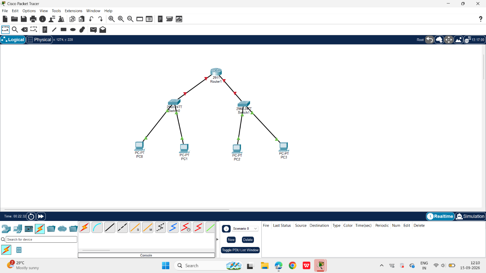
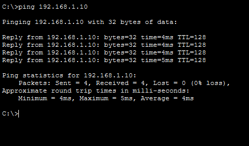
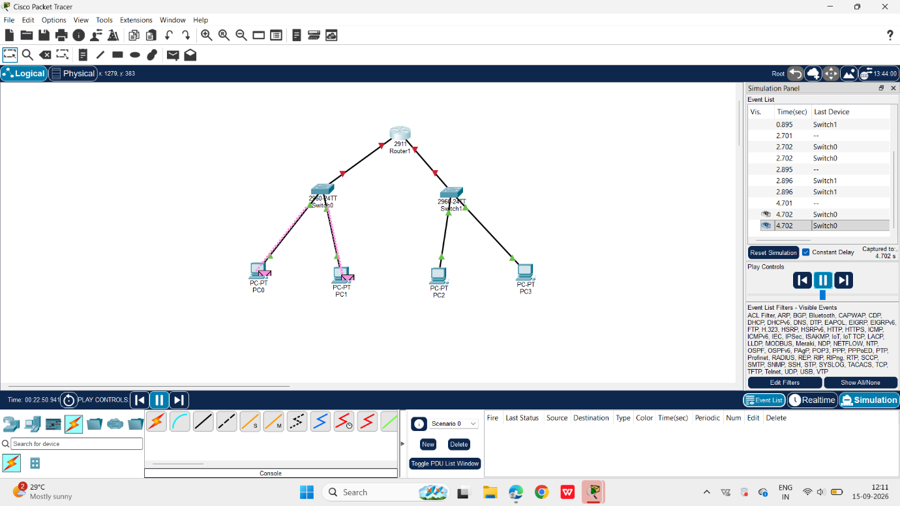

# Unit 1: Building a Local Area Network (LAN) in Cisco Packet Tracer

**Course:** Network Models and Protocols / Networking Protocols & Communication (NPC)  
**Unit:** Unit 1 – Introduction to Networking and Data Communication  
**Author:** Yash Kawade  
**PRN:** 2125UCSM1118  
**Department:** Cyber Security  
**Institution:** Sanjivani University, Kopargaon  
**Repository:** [Network-Models-and-Protocols](https://github.com/kawdeyash/Network-Models-and-Protocols)

---

## 1. Project Overview & Task Outline

- **Task:** Download and install Cisco Packet Tracer (via Cisco Networking Academy). Build a Local Area Network (LAN) consisting of **1 Router**, **2 Switches**, and **4 PCs**. Assign static IP addresses to all PCs. Demonstrate successful network communication by pinging across the switches.
- **Deliverables:**
  - Complete Cisco Packet Tracer project topology (`ASSIGNMENT.pkt`)
  - Verification screenshots of topology, successful ICMP ping responses, and simulation panel event lists
  - Comprehensive Mini-Project documentation and reports (`.pdf`, `.docx`, `.md`)

---

## 2. Hardware and Software Specifications

| Component | Model / Type | Quantity | Role in Network |
|---|---|---|---|
| **Simulation Platform** | Cisco Packet Tracer (v8.x / v9.x) | 1 | Design, configuration, and packet-level simulation |
| **Router** | Cisco 2911 Integrated Services Router (`Router1`) | 1 | Default gateway and inter-segment routing |
| **Switch 0** | Cisco Catalyst 2960-24TT (`Switch0`) | 1 | Layer-2 LAN switch for Workgroup A (PC0, PC1) |
| **Switch 1** | Cisco Catalyst 2960-24TT (`Switch1`) | 1 | Layer-2 LAN switch for Workgroup B (PC2, PC3) |
| **End Devices** | PC-PT (`PC0`, `PC1`, `PC2`, `PC3`) | 4 | Client workstations generating network traffic |
| **Cabling** | Copper Straight-Through (Ethernet) | 6 | FastEthernet and GigabitEthernet links between devices |

---

## 3. Network Topology & Architecture

The Local Area Network is structured hierarchically:
- **Router1** connects to **Switch0** and **Switch1** via its GigabitEthernet interfaces.
- **Switch0** provides Layer-2 local switching for workstations `PC0` and `PC1`.
- **Switch1** provides Layer-2 local switching for workstations `PC2` and `PC3`.
- Workstations within the same switch communicate directly at Layer-2 via MAC address learning, while cross-switch communication flows through the network backbone.

```
                  +-------------------+
                  |  Router1 (2911)   |
                  +---------+---------+
                            |
             +--------------+--------------+
             |                             |
      +------+------+               +------+------+
      | Switch0     |               | Switch1     |
      | (2960-24TT) |               | (2960-24TT) |
      +---+-----+---+               +---+-----+---+
          |     |                       |     |
      +---+     +---+               +---+     +---+
      |             |               |             |
   +--+---+      +--+---+        +--+---+      +--+---+
   | PC0  |      | PC1  |        | PC2  |      | PC3  |
   +------+      +------+        +------+      +------+
```

  
*Figure 1: Logical network topology in Cisco Packet Tracer.*

---

## 4. IP Addressing Scheme

Static IPv4 addresses and subnet masks configured across all devices:

| Device | Interface | IPv4 Address | Subnet Mask | Default Gateway | Status |
|---|---|---|---|---|---|
| **Router1** | `GigabitEthernet0/0` | `192.168.1.1` | `255.255.255.0` | — | Configured |
| **Router1** | `GigabitEthernet0/1` | `192.168.2.1` | `255.255.255.0` | — | Configured |
| **PC0** | `FastEthernet0` | `192.168.1.10` | `255.255.255.0` | `192.168.1.1` | Active |
| **PC1** | `FastEthernet0` | `192.168.1.11` | `255.255.255.0` | `192.168.1.1` | Active |
| **PC2** | `FastEthernet0` | `192.168.1.12` | `255.255.255.0` | `192.168.1.1` | Active |
| **PC3** | `FastEthernet0` | `192.168.1.13` | `255.255.255.0` | `192.168.1.1` | Active |

---

## 5. Configuration Procedure

1. **Topology Deployment:**
   - Launched Cisco Packet Tracer and dragged one **Cisco 2911 Router**, two **Cisco Catalyst 2960 Switches**, and four **PC-PT workstations** onto the logical workspace.
2. **Physical Cabling:**
   - Connected `PC0` (FastEthernet0) to `Switch0` (FastEthernet0/1).
   - Connected `PC1` (FastEthernet0) to `Switch0` (FastEthernet0/2).
   - Connected `PC2` (FastEthernet0) to `Switch1` (FastEthernet0/1).
   - Connected `PC3` (FastEthernet0) to `Switch1` (FastEthernet0/2).
   - Connected `Switch0` and `Switch1` to `Router1` using Copper Straight-Through cables.
3. **Workstation Configuration:**
   - Opened each PC's **Desktop → IP Configuration** tab.
   - Set IP assignment to **Static** and applied the corresponding IP address, subnet mask (`255.255.255.0`), and default gateway.
4. **Verification:**
   - Executed ICMP `ping` commands from workstation Command Prompts to verify end-to-end connectivity.
   - Inspected packet flows using Packet Tracer's **Simulation Mode**.

---

## 6. Connectivity Verification & Results

### 6.1 ICMP Ping Verification
From the Command Prompt of workstation `PC1`, a ping test was conducted toward target host `192.168.1.10`:

```cmd
C:\>ping 192.168.1.10

Pinging 192.168.1.10 with 32 bytes of data:

Reply from 192.168.1.10: bytes=32 time=4ms TTL=128
Reply from 192.168.1.10: bytes=32 time=4ms TTL=128
Reply from 192.168.1.10: bytes=32 time=4ms TTL=128
Reply from 192.168.1.10: bytes=32 time=5ms TTL=128

Ping statistics for 192.168.1.10:
    Packets: Sent = 4, Received = 4, Lost = 0 (0% loss),
Approximate round trip times in milli-seconds:
    Minimum = 4ms, Maximum = 5ms, Average = 4ms
```

  
*Figure 2: Successful 0% packet loss ping test on Command Prompt.*

### 6.2 Simulation Mode Analysis
Packet Tracer simulation mode confirms proper packet encapsulation, ARP resolution, and Layer-2 frame switching:

- **Workgroup A (PC0 ↔ PC1):** Packets forwarded seamlessly through `Switch0`.
  
    
  *Figure 3: Simulation event list and packet delivery between PC0 and PC1.*

- **Workgroup B (PC2 ↔ PC3):** Packets forwarded seamlessly through `Switch1`.
  
    
  *Figure 4: Simulation event list and packet delivery between PC2 and PC3.*

---

## 7. Project Files

- [`ASSIGNMENT.pkt`](ASSIGNMENT.pkt): Cisco Packet Tracer topology and configuration file
- [`Unit_1_LAN_Mini_Project_Report.pdf`](Unit_1_LAN_Mini_Project_Report.pdf): Complete formatted PDF project report
- [`Unit_1_LAN_Mini_Project_Report.docx`](Unit_1_LAN_Mini_Project_Report.docx): Editable Microsoft Word report
- [`screenshots/`](screenshots/): High-resolution topology, ping, and simulation capture files
